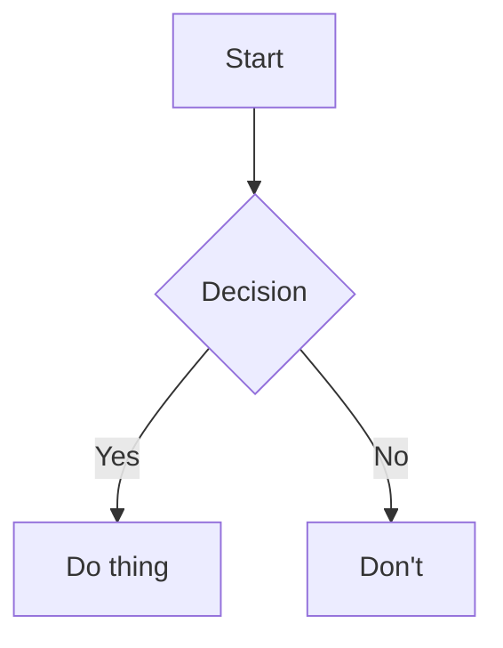

# Handbook-Style Documentation

Produce documentation that helps a defined audience complete a task or understand a system.
Preserve correct project-specific conventions rather than replacing them with personal taste.
Repository instructions, the target renderer, and the existing documentation toolchain take precedence over this skill's defaults.

## Workflow

1. Inspect existing documentation, relevant code, repository conventions, and documentation build configuration.
2. Check whether the target is generated, mirrored, translated, vendored, or derived from another authoritative source; edit that source instead.
3. Identify the audience, document purpose, and information readers need first.
4. Choose a structure suited to that purpose; do not force every document into the same template.
5. Draft the smallest complete explanation, using examples where they remove ambiguity.
6. Verify commands, paths, configuration keys, links, and behaviour against authoritative project sources.
7. Run the existing documentation checks or renderer when available; report anything that could not be verified rather than guessing or installing tooling.
8. Review the rendered structure and raw Markdown for clarity and maintainability.

## Writing Style

- Apply the global language and tone rules consistently to headings, prose, examples, and callouts.
- Remove filler, throat-clearing, and repeated conclusions.
- Use humour only when it does not obscure instructions or trivialise risk.
- Use active voice. Passive voice is acceptable when the actor is irrelevant
- Write for someone who will read this at 11pm after a long day. Be clear

## Markdown Formatting

### Alerts / Admonitions

When the target renderer supports them, use GitHub/GitLab-style alerts for information that deserves emphasis outside the main flow:

```markdown
> [!NOTE]
> Supplementary information the reader should know.

> [!TIP]
> Helpful advice for doing things better or more easily.

> [!IMPORTANT]
> Key information the reader needs to succeed.

> [!WARNING]
> Urgent information about potential problems or risks.

> [!CAUTION]
> Negative potential consequences of an action.
```

### Diagrams

Use **Mermaid** when relationships, sequence, or state are clearer visually than in prose:

````markdown

````

Do not set a Mermaid theme unless the project already specifies one; documentation should remain readable in light and dark renderers.
Summarise the diagram's important conclusion in prose so it is not the only source of information.

### Collapsible Sections

Use `<details>` for supplementary content that would clutter the main flow:

```markdown
<details>
<summary><i>Optional: nerdy details</i></summary>

Content here. Markdown **works** inside.

</details>
```

### Code Blocks

- Specify a supported language for syntax highlighting; use `text` for plain output or unsupported syntax.
- Use `console` for terminal output, `bash`/`sh` for shell commands
- Add comments in code blocks to explain non-obvious steps
- For config files, use the appropriate language (`toml`, `yaml`, `ini`,
  `json`, `dockerfile`, `gitattributes`, etc.)

### Tables

- Use tables for compact comparisons and structured data only when they remain readable on narrow screens.
- Left-align text columns, centre status/boolean columns
- Let the repository formatter decide pipe alignment when one is configured.

### Line Length and Wrapping

- Prefer one sentence per line when the repository has no conflicting formatter or convention.
- Do not hard-wrap prose at 80 characters unless the repository requires it.
- Break long bullet points across lines with proper indentation

### Equations

Treat display equations (`$$`) as part of the surrounding sentence.
Do not introduce them with a colon.
End an equation with a full stop when it ends the sentence, or a comma when the sentence continues.

## Document Structure

### README Files

Select relevant sections rather than generating an empty standard shell.
A typical software README may include:

1. **Summary** — what it is, who it is for, and why it exists.
2. **Requirements** — only prerequisites the reader must satisfy.
3. **Installation** — when installation or setup is required.
4. **Usage** — the shortest working example followed by common operations.
5. **Development** — when contributors need distinct setup or verification steps.
6. **Support and licence** — when the project needs those routes made explicit.

### Larger Documentation

Use the **Diataxis** model to separate different reader needs across a documentation set:

- **Tutorials** — learning-oriented, step-by-step
- **How-to guides** — task-oriented, practical
- **Reference** — information-oriented, precise
- **Explanation** — understanding-oriented, conceptual

### Architecture Documentation

For system architecture, choose the lightest notation that answers the reader's question:

- **C4 model** — context, containers, components, code
- **arc42** — comprehensive structure for content and communication

Explain important boundaries and decisions in prose even when a diagram is present.

## Linting and Formatting

- Use the repository's existing Markdown formatter and linter.
- Prefer `prettier` and `markdownlint-cli2` when establishing new project conventions.
- Prefer MkDocs when a new documentation site is needed and the project has no existing renderer.
- Integrate checks into the project's existing format-check command rather than inventing a second entry point.
- Do not install tools or reformat unrelated documentation without approval.

## Quality Check

Before finishing, confirm that:

- The opening explains the document's purpose and intended audience.
- Headings form a useful outline and do not merely divide a wall of prose into smaller walls.
- Commands and examples are complete enough to run and match current project behaviour.
- Links, filenames, configuration keys, and terminology are consistent.
- Warnings explain the consequence and the safer action.
- Links use meaningful text, headings form a logical hierarchy, and visual content has an equivalent explanation.
- The change does not duplicate or contradict another authoritative document.

## Things to Avoid

- Unnecessary emojis (unless the user explicitly asks)
- Overly formal or academic tone
- Walls of text without structure
- Documentation that restates the obvious from code
- Stale documentation that contradicts the actual behaviour
